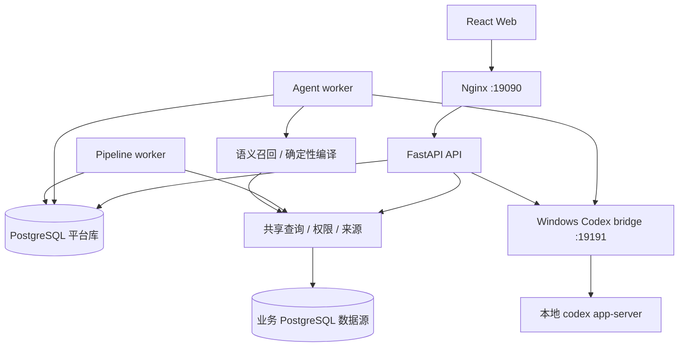

# 架构与权威边界

Web 通过同源 cookie/CSRF 使用 API。API、Agent worker 和 pipeline worker 共享业务代码与平台 PostgreSQL，维护各自运行状态。Agent worker 处理长时模型/问数；pipeline worker 负责数据工程任务，不能互相替代状态机。

| 事实 | 唯一权威 | 下游引用 |
| --- | --- | --- |
| 连接及加密凭据 | 数据源与安全服务 | datasource ID 与用途 |
| 真实物理结构 | 采集观察 / CatalogSnapshot | 不可变快照、指纹、FieldRef |
| 设计模型 | 建模文档与修订 | 模型 revision / 发布计划 |
| 加工任务及数据 | 定义修订、运行、提交回执、DataBatch | task/run/batch 身份 |
| 业务定义与映射 | AssetRevision | Metric/Binding/Entity 等确切引用 |
| 语义使用版本 | Release + IndexSnapshot + Deployment | 运行创建时固定完整二元组 |
| 本次需求和执行 | Agent run/requirement/QueryFrame/授权/执行 | 追加事件与 CAS 版本 |

运行数据库使用 Schema 5；启动仅建立历史基础表，完整部署必须通过[初始化命令](../../README.md#3-首次初始化数据库)顺序运行显式 v4/v5 迁移。SQL 文件是结构参考，ORM 与迁移命令决定实际行为。

原有 shared main.py/db.py 和前端 main.jsx 仍包含多个业务入口，文件归属允许重叠。[模块清单](../../project/modules.json)与[模块维护指南](../maintenance/modules.md)界定变更评审范围，本次保留既有路径与业务接口。

当前部署保留本机入口、只读 API 根文件系统、加密数据源凭据及 token 文件挂载。CLI 的能力开关不构成已验证的 OS 隔离；详情见[配置](../deployment/configuration.md)。
