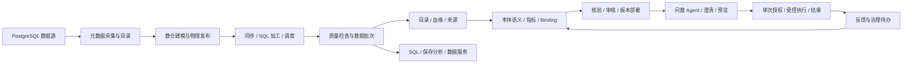

# 功能与应用介绍

OntoDataWorks 面向需要同时管理“数据如何生产”和“业务口径如何被使用”的数据团队。平台提供数据工程底座，语义模块管理本体与指标权威，Agent 在固定口径和受控授权下解析问题、规划查询与交付结果。

## 应用主链

## 平台功能

| 功能 | 用户可以做什么 | 当前实现范围 |
| --- | --- | --- |
| 空间与权限 | 登录、切换空间、配置成员、审计操作 | cookie 会话、CSRF、admin/developer/viewer、空间隔离；数据权限另外检查 |
| 数据源与目录 | 配置连接、测试、采集表字段、维护中文业务释义、预览数据 | PostgreSQL；物理指纹与业务释义分别维护 |
| 数仓建模 | 维护域、维度、指标、分层模型与粒度 | ODS/DWD/DWS/DIM/ADS；固定修订与受控 DDL 发布 |
| 数据任务 | 定义采集、同步、加工和质量任务 | 有界批式任务、replace/upsert、主键/水位、固定定义版本 |
| 运行中心 | 查看调度、attempt、批次、质量、异常、重试和对账 | 持久任务、Cron 时区、同批次依赖；UNKNOWN 需核对实际提交状态 |
| 质量与来源 | 维护规则、查看检查结果、追溯来源 | 非空、唯一、范围、枚举、行数、引用等规则；受支持 SQL 范围的血缘 |
| 语义资产 | 维护本体定义、指标、映射、来源证据与审核 | 类型化不可变修订、目录快照、Release/Index/Deployment |
| 智能问数 | 自然语言提问、逐项澄清、确认口径、预览、授权、查看结果 | 真实本地 CLI 意图解析；固定语义与确定性编译；生产执行禁用 |
| 数据消费 | SQL、保存分析、图表、CSV/Excel、参数化数据服务 | 重查权限、契约修订、消费方授权、调用预算与审计 |

一期“维度/指标/逻辑模型”是设计文档；二期语义 Metric/Binding 是执行口径，二者有独立身份与发布链路。

数据地图的表工作页、字段血缘与查询证据使用方式见 [v1.2 数据地图与血缘](data-map-lineage.md)。

## 推荐使用过程

1. 管理员建立工作空间和数据源，分别登记源读、目标写、DDL、目标读用途，并在 PostgreSQL 设置对应最小权限。
2. 采集实际结构，维护中文名称、定义、粒度与分级；模型预检和发布后重新回读目标结构。
3. 创建同步/加工任务及质量规则，在运行中心确认实际数据批次和可用时间。
4. 维护语义指标和 Binding，核对业务定义、物理字段、时间事件、维度、JOIN、单位/币种与来源。
5. 通过独立核验/审核和显式部署取得可用口径；本地技术快照与生产批准分别展示。
6. 用户提问后逐项澄清和确认，检查 SQL 预览及范围，再对这次查询授权。反馈进入治理待办。

## 当前限制

主要连接器是 PostgreSQL。并非阿里云 DataWorks 全功能替代，也未接通其 OpenAPI。Exact/BM25/依赖图已实现，Vector 当前关闭。复杂同比环比规划、未知金额币种、未治理状态或不支持的维度/连接会阻断；不能用总额代替增长值。桌面 CLI 桥接仅覆盖本地公开/合成材料验证，不代表生产身份、OS 隔离、HA 或长时间压力测试已完成。

更多细节见[语义与 Agent](semantic-agent.md)、[能力映射](dataworks-capabilities.md)和[架构](../architecture/README.md)。
